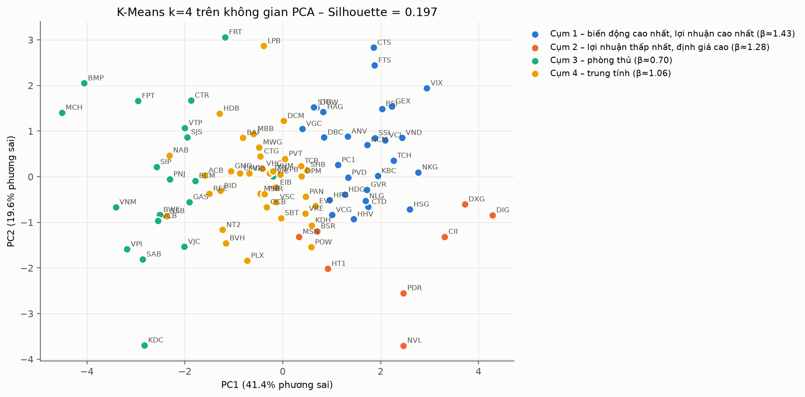
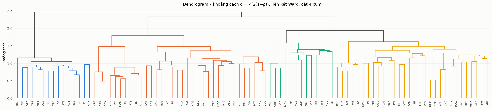

# Vietnam Stock Data Warehouse & Stock Clustering

End-to-end data project on the **VN100** basket (100 large-cap stocks on HOSE), 2020–2025:
ETL pipeline → PostgreSQL data warehouse (Galaxy schema) → OLAP analysis in SQL → K-Means / hierarchical clustering → Power BI dashboard.

Course project for *Data Warehousing & Data Mining*, PTIT (team of 3 — Team Leader: Hoàng Ngọc Tú).
Vietnamese documentation: [`docs/README_vi.md`](docs/README_vi.md).

## Highlights

| | |
|---|---|
| Data | 6 years of daily OHLCV prices for 100 tickers + VN-Index/VN30 + quarterly financial ratios, pulled from the `vnstock` API (VCI source) |
| Warehouse | PostgreSQL, 3 schemas (`staging`, `dw`, `meta`), **3 fact tables + 4 dimensions** (Galaxy / fact constellation) |
| Modelling | SCD Type 2 on `dim_stock` (exchange / industry changes), SCD Type 1 on company name, yearly range partitions on the price fact |
| ETL | Incremental load via per-ticker watermark, idempotent `INSERT … ON CONFLICT`, raw snapshots saved for replay |
| Data quality | 7 rules → 12 rows rejected, 404 rows flagged (returns exceeding the exchange price limit), logged to `meta.dq_issue` |
| OLAP | 9 queries: ROLLUP, CUBE, slice, drill-down, dice + RANK, beta, drill-across, SCD2 history, DQ report |
| Mining | 8 features per stock → K-Means (k = 4) + Ward clustering on correlation distance; evaluated with Silhouette, ARI, NMI |
| Result | Picking 1 stock per cluster gives **19.7 %** annual volatility vs **27.5 %** median of 2,000 random 4-stock portfolios (lower than 99 % of them) |

## Architecture

```
vnstock API ──► Extract ──► Transform (pandas, DQ rules) ──► staging.* ──► Load (SQL) ──► dw.*  ──► OLAP SQL / Power BI
                  │                                                         │
                  └── data/raw/<run_id>/*.csv                               └── meta.etl_log, meta.dq_issue
                                                                    dw.* ──► mining/clustering.py ──► dw.mining_cluster_result
```

### Schema

| Table | Grain / role |
|---|---|
| `dim_date` | 1 calendar day (2015–2030), `is_trading_day`, `is_quarter_end` flags |
| `dim_stock` | SCD2: new version when exchange or industry changes (`valid_from`, `valid_to`, `is_current`) |
| `dim_industry` | ICB hierarchy L1 → L2 → L3 (drill-down) |
| `dim_exchange` | HOSE / HNX / UPCOM with daily price limit (7 / 10 / 15 %) |
| `fact_daily_price` | 1 ticker × 1 session, partitioned by year, pre-computed `daily_return`, `log_return` |
| `fact_index_daily` | 1 index × 1 session (VNINDEX, VN30), used for beta |
| `fact_financial_ratio` | 1 ticker × 1 quarter: P/E, P/B, ROE, ROA, EPS, D/E, net margin |

## Clustering results (92 stocks, 2021–2025)

| Cluster | # | Ann. return | Ann. vol | Beta | Profile |
|---|---|---|---|---|---|
| 1 | 28 | 24.7 % | 45.5 % | 1.43 | High-beta: brokers, steel, construction (SSI, HPG, VND…) |
| 2 | 8 | 11.3 % | 44.2 % | 1.28 | Weak real-estate, high P/E (NVL, PDR, DIG…) |
| 3 | 19 | 19.9 % | 30.7 % | 0.70 | Defensive: consumer, utilities (FPT, VNM, GAS, VCB…) |
| 4 | 37 | 20.1 % | 35.2 % | 1.06 | Market-like: most banks (ACB, MBB, TCB…) |

Correlation-based hierarchical clustering matches the ICB sectors better than feature-based K-Means
(NMI 0.40 vs 0.24), i.e. stocks co-move by sector, but their risk–return profile cuts across sectors.

<p>


</p>

More charts in [`docs/images/`](docs/images), CSV outputs in [`outputs/sample/`](outputs/sample).

## Run it

```bash
docker compose up -d                       # PostgreSQL (or use a local instance with DB stock_dw)
python -m venv .venv && source .venv/bin/activate
pip install -r requirements.txt
pip install -U --extra-index-url https://vnstocks.com/api/simple vnstock vnai
cp .env.example .env                       # edit DB_URL

# Offline smoke test with simulated data (tickers start with Z)
python -m etl.run_etl --mock --init-db --end 2025-06-30 --effective-date 2025-06-30
python -m etl.run_etl --mock --mock-change --end 2025-12-31 --effective-date 2025-07-01   # tests SCD2

# Real data
python -m etl.run_etl --init-db            # full VN100, 2020-01-01 → 2025-12-31
python -m etl.run_etl --end 2026-10-31     # incremental: only new sessions
python -m mining.clustering --start 2021-01-01 --end 2025-12-31 --k 4 --exclude KOS
```

OLAP queries: [`sql/02_olap_queries.sql`](sql/02_olap_queries.sql).

## Project structure

```
sql/01_create_schema.sql    schemas, dimensions, partitioned facts, Power BI view
sql/02_olap_queries.sql     9 OLAP queries
etl/run_etl.py              orchestration, watermark-based incremental load
etl/transform.py            cleaning + 6 reject rules
etl/load.py                 11 SQL load steps (SCD1, SCD2, facts, returns, DQ flag)
etl/sources/                vnstock adapter (retry, rate limit) + mock source
mining/clustering.py        features → choose k → K-Means + Ward → ARI/NMI → diversification test
```

## Tech stack

Python (pandas, NumPy, scikit-learn, SciPy, SQLAlchemy, matplotlib) · PostgreSQL · SQL (window functions, ROLLUP/CUBE, partitioning) · Docker · Power BI
